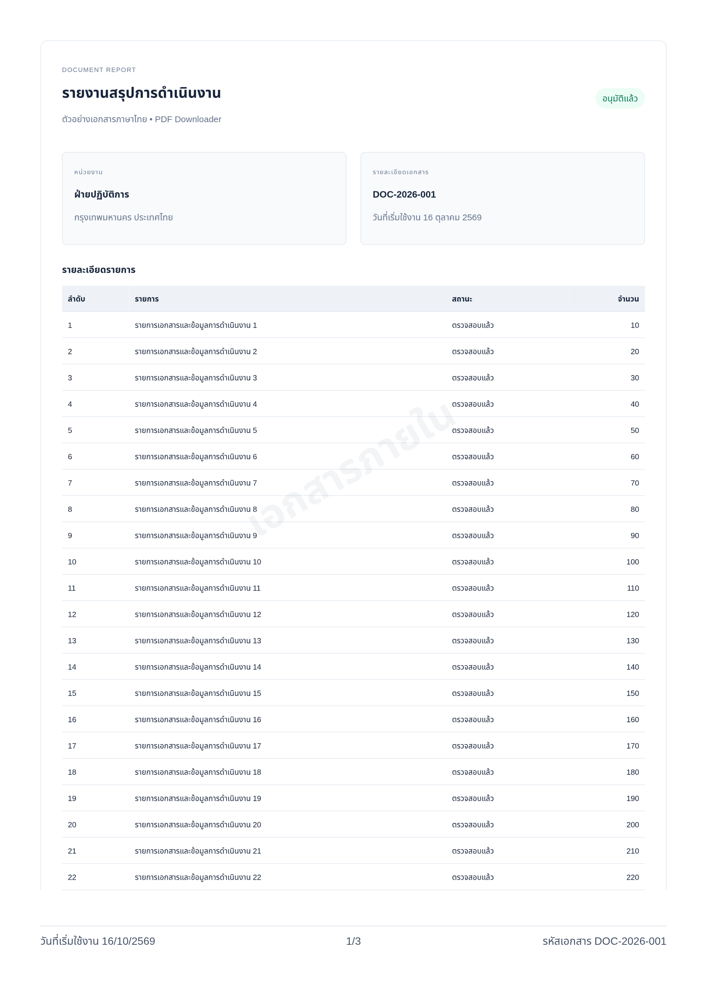

<div align="center">

# PDF Downloader

**ส่งออกเอกสารจาก Budibase เป็น PDF พร้อมโลโก้ ลายน้ำ และท้ายกระดาษ**

[](https://github.com/Tkyaemsuk/PDF-Downloader/releases/tag/v1.0.4)
[](https://github.com/Budibase/budibase/tree/3.4.1)
[](https://svelte.dev/)
[](LICENSE)

[**ดาวน์โหลด v1.0.4**](https://github.com/Tkyaemsuk/PDF-Downloader/releases/tag/v1.0.4) · [ติดตั้ง](#installation) · [ตั้งค่า](#configuration) · [ประวัติเวอร์ชัน](CHANGELOG.md)

</div>

---

PDF Downloader เป็น custom component สำหรับ **Budibase 3.4.1** พัฒนาด้วย **Svelte 3.59.2** ช่วยเปลี่ยนแบบฟอร์ม รายงาน และเอกสารที่แสดงในแอปให้เป็นไฟล์ PDF ผ่านปุ่ม **PDF Download** โดยตั้งค่าได้จากแผง component

เหมาะสำหรับแบบฟอร์มที่มีส่วนลงชื่อ รายงานหลายหน้า และเอกสารภายในองค์กรที่ต้องการรูปแบบท้ายกระดาษสม่ำเสมอ ประมวลผล PDF ภายในเบราว์เซอร์ โดยไม่มีบริการภายนอกสำหรับรับเนื้อหาเอกสาร

> **รูปแบบไฟล์:** PDF เก็บแต่ละหน้าเป็นภาพเพื่อรักษาหน้าตาและภาษาไทย ข้อความจึงไม่สามารถเลือกหรือค้นหาได้ และส่งออกเฉพาะเนื้อหาที่โหลดแล้วในหน้าจอ

## ความสามารถหลัก

| ความสามารถ | รายละเอียด |
| :--- | :--- |
| **จัดหน้าเอกสาร** | A4 / Letter แนวตั้งหรือแนวนอน พร้อมขอบกระดาษที่ปรับได้ |
| **แบบฟอร์มแยกหน้า** | ใช้ class `pdf-page` จัดแต่ละชุดพร้อมส่วนหัวและลงชื่อเป็นกระดาษหนึ่งหน้า |
| **พอดีหนึ่งหน้า** | ย่อทั้งความกว้างและความสูง โดยกันพื้นที่ท้ายกระดาษก่อน เพื่อรวมส่วนลงชื่อ |
| **รายงานหลายหน้า** | แบ่งหน้าอัตโนมัติ พร้อมพยายามหลีกเลี่ยงการตัดกลางแถวตารางและย่อหน้า |
| **โลโก้ส่วนหัว** | รักษาสัดส่วนจริงของรูป กำหนดขนาดสูงสุดและเลือกโลโก้ด้วย CSS selector |
| **ท้ายกระดาษ** | วันที่เริ่มใช้งานด้านซ้าย เลขหน้าตรงกลาง และรหัสเอกสารด้านขวา |
| **ลายน้ำ** | ข้อความหรือรูปภาพ พร้อมปรับความเข้มและมุม |
| **ข้อมูลแบบไดนามิก** | ตั้งข้อความ วันที่ รหัสเอกสาร และชื่อไฟล์ผ่าน component bindings |
| **คงหน้าจอเดิม** | จัดรูปแบบในสำเนาสำหรับสร้าง PDF โดยไม่เปลี่ยนเอกสารที่ผู้ใช้กำลังดู |

<details>
<summary><strong>ดูตัวอย่างเอกสาร PDF</strong></summary>

ตัวอย่างจากหน้า demo: เอกสารภาษาไทย ตาราง ลายน้ำ และท้ายกระดาษ ข้อมูลทั้งหมดเป็นข้อมูลตัวอย่าง

<p align="center">
  
</p>

</details>

<a id="installation"></a>

## เริ่มต้นใช้งาน

### 1. ติดตั้งปลั๊กอิน

1. ดาวน์โหลด **`pdf-downloader-1.0.4.tar.gz`** จาก [Release v1.0.4](https://github.com/Tkyaemsuk/PDF-Downloader/releases/tag/v1.0.4) ในส่วน **Assets** — ไม่ใช่ Source code ZIP/TAR
2. เปิด **Plugins** ใน Budibase workspace แล้วอัปโหลดไฟล์ `.tar.gz` โดยไม่แตกไฟล์
3. เปิดแอปใน **Design** แล้วเพิ่ม component **PDF Downloader** หรือ `pdf-downloader`
4. ตั้งค่าเอกสาร แล้วทดสอบปุ่ม **PDF Download** ใน **Preview**

บัญชีและการติดตั้ง Budibase ต้องเปิดใช้ custom plugins หากดาวน์โหลดจาก Release ไม่ได้ ใช้ [แพ็กเกจใน repository](releases/pdf-downloader-1.0.4.tar.gz) แล้วกด **Download raw file**

### 2. เลือกเนื้อหาที่ต้องการส่งออก

**วิธีแนะนำ — วางเอกสารภายในปลั๊กอิน**

```text
Screen
└── PDF Downloader
    └── Container เอกสาร
        ├── โลโก้และชื่อบริษัท
        ├── รายละเอียด / ตาราง
        └── ส่วนลงชื่อ
```

เว้น **CSS selector ของเอกสาร** ไว้ว่าง ปลั๊กอินจะส่งออก components ภายใน โดยไม่รวมปุ่มดาวน์โหลดและข้อความสถานะ

**ปุ่มอยู่นอกเอกสาร — ระบุ CSS selector**

กรอก selector ที่ตรงกับเอกสารหนึ่งรายการ เช่น `#report`, `.report-document` หรือ `[data-id="รหัส-component-จริง"]` โดยต้องเป็น ID/class/attribute ที่มีจริงใน DOM ภายในหน้าจอแอป ชื่อในต้นไม้ เช่น `Container 30` ไม่ใช่ CSS selector

### 3. ตั้งค่าสำหรับแบบฟอร์มหน้าเดียว

| รายการ | ค่าแนะนำ |
| :--- | :--- |
| ขนาด / แนวกระดาษ | A4 / portrait |
| การจัดหน้า PDF | **พอดีหนึ่งหน้า — รวมส่วนลงชื่อ** |
| ขอบกระดาษ | 12 มม. |
| ความละเอียด | 2 |
| ปรับสัดส่วนโลโก้ส่วนหัว | เปิด |
| ขนาดสูงสุดโลโก้ | กว้าง 28 × สูง 20 มม. |

เอกสารยาวควรใช้โหมด **อัตโนมัติ** หรือ **หลายหน้า** เพื่อให้ตัวอักษรอ่านง่าย

<a id="configuration"></a>

## แบบฟอร์มหลายชุด: หน้าแรกถูก แต่หน้าที่สองเลื่อนหรือมีหน้าลงชื่อเกิน

ตั้ง **การจัดหน้า PDF → แบบฟอร์มแยกหน้า — หนึ่งชุดต่อหน้า** แล้วกำหนด **CSS selector ของหน้าแบบฟอร์ม** เป็น `.pdf-page` (ค่าเริ่มต้น) แต่ละชุดต้องมี Container ของตัวเองที่รวม **ส่วนหัว + ตาราง/ข้อมูล + ส่วนลงชื่อ**

```text
PDF Downloader
└── Container เอกสารรวม
    ├── Container ชุดที่ 1  [class: pdf-page]
    │   ├── ส่วนหัว       [class: pdf-header]
    │   ├── เนื้อหา
    │   └── ส่วนลงชื่อ    [class: pdf-signatures]
    └── Container ชุดที่ 2  [class: pdf-page]
        ├── ส่วนหัว       [class: pdf-header]
        ├── เนื้อหา
        └── ส่วนลงชื่อ    [class: pdf-signatures]
```

class เหล่านี้เป็นเครื่องหมายให้ปลั๊กอิน ไม่ต้องเขียน CSS เพื่อบังคับพิกัด และไม่บังคับเปลี่ยนหน้า Budibase เดิม ดู [โครงสร้าง HTML ตัวอย่าง](docs/examples/page-classes.html)

**ถ้า component ใน Budibase ไม่มีช่องเพิ่ม class:** ไม่ต้องใส่ข้อความ `class=...` ในช่อง Styles/CSS ให้ใช้ selector ของ Container ที่มีอยู่แทน เช่น `[data-id="รหัสชุดแรก"], [data-id="รหัสชุดสอง"]` ใน **CSS selector ของหน้าแบบฟอร์ม** โดยแทนด้วย ID จริงจาก DOM ภายใน Preview ไม่ใช่ ID ของกรอบ editor หรือชื่อในต้นไม้ รองรับ wrapper ของ Budibase ที่ใช้ `display: contents`

| Class | หน้าที่ |
| :--- | :--- |
| `pdf-page` | ขอบเขตหนึ่งแบบฟอร์มต่อหนึ่งกระดาษ ต้องรวมส่วนลงชื่อและไม่ซ้อนกับ pdf-page อื่น |
| `pdf-header` | ส่วนหัวที่ควรอยู่ด้วยกันเมื่อใช้การแบ่งหน้าปกติ |
| `pdf-logo` | เลือกโลโก้ของแต่ละชุด; ใส่บน img หรือ container ที่มี img |
| `pdf-signatures` / `pdf-keep` | กลุ่มเนื้อหาที่ควรอยู่ด้วยกันเมื่อแบ่งหน้าปกติ |
| `pdf-break-before` | บังคับเริ่มหน้าใหม่ในโหมดแบ่งหน้าปกติ |

โหมดแยกหน้าจะส่งออก **เฉพาะ Container ที่ selector เลือก** ตามลำดับ DOM ไม่รวมช่องว่างระหว่างชุดหรือเนื้อหานอก Container แต่ละชุดจะคงสัดส่วน จัดกลางแนวนอน และย่อเท่าที่จำเป็นเพื่อให้ครบในพื้นที่ก่อน footer โลโก้ถูกปรับทุกชุด เลขหน้าและลายน้ำยังเป็นของแต่ละกระดาษ การย่ออิสระอาจทำให้ขนาดตัวอักษรของชุดที่ยาวกว่าเล็กลง

โหมด **อัตโนมัติ** ก็ใช้ขอบเขตนี้เมื่อพบ `.pdf-page`; หากไม่พบจะแบ่งแบบเดิม โหมด **พอดีหนึ่งหน้า** หมายถึงเอกสารรวมทั้งหมดหนึ่งหน้า ส่วน **หลายหน้า** ใช้การแบ่งภาพต่อเนื่องแบบเดิม ไม่ใช้ขอบเขตแบบฟอร์ม

## การตั้งค่า component

### หน้ากระดาษและไฟล์

| ตัวเลือก | ค่าเริ่มต้น | รายละเอียด |
| :--- | :--- | :--- |
| CSS selector ของเอกสาร | ว่าง | ส่งออก children; หากกำหนดต้องตรงหนึ่งรายการ |
| ชื่อไฟล์ PDF | `document` | รองรับภาษาไทยและ binding |
| ขนาดกระดาษ | A4 | A4 หรือ Letter |
| แนวกระดาษ | portrait | portrait หรือ landscape |
| CSS selector ของหน้าแบบฟอร์ม | `.pdf-page` | ใช้ในโหมดแยกหน้าและอัตโนมัติ |
| การจัดหน้า PDF | อัตโนมัติ | รวมส่วนที่เกินหน้าเล็กน้อยโดยย่อไม่เกิน 20%; หรือเลือกหนึ่งหน้า/หลายหน้า |
| ขอบกระดาษ | 12 มม. | ปรับได้ 5–30 มม. |
| ความละเอียด | 2 | ปรับได้ 1–3; ลดเหลือ 1 หากเอกสารยาว |
| ปิดใช้งานปุ่ม | ปิด | รองรับ boolean binding |

### โลโก้ส่วนหัว

| ตัวเลือก | ค่าเริ่มต้น | รายละเอียด |
| :--- | :--- | :--- |
| ปรับสัดส่วนโลโก้ส่วนหัว | เปิด | ใช้อัตราส่วนจริงของไฟล์ภาพ |
| CSS selector โลโก้ | ว่าง | เลือกรูปที่มองเห็นรูปแรกในส่วนหัวอัตโนมัติ |
| ความกว้างสูงสุดโลโก้ | 28 มม. | ปรับได้ 8–60 มม. |
| ความสูงสูงสุดโลโก้ | 20 มม. | ปรับได้ 8–40 มม. |

โลโก้จะไม่ขยายเกินพื้นที่ภาพเดิม เพื่อไม่เบียดข้อความส่วนหัว หากต้องการขยายมากกว่านั้น ให้ปรับ Image component ใน Budibase ก่อน ขนาดมิลลิเมตรอ้างอิงการจัดพอดีความกว้างกระดาษ; โหมดหนึ่งหน้าอาจย่อโลโก้ลงพร้อมเอกสาร

หากรูปแรกไม่ใช่โลโก้ ให้ระบุ selector เช่น `img.company-logo` หรือ container ที่มี `img` เพียงรูปเดียว รองรับรูป SVG ที่โหลดผ่าน `img` แต่ไม่ปรับ inline SVG หรือ CSS background

### ท้ายกระดาษและลายน้ำ

```text
วันที่เริ่มใช้งาน 16/10/2569             1/3             รหัสเอกสาร DOC-2026-001
```

| ตัวเลือก | ค่าเริ่มต้น / ขอบเขต |
| :--- | :--- |
| ข้อความท้ายซ้าย | `วันที่เริ่มใช้งาน` — แก้ไขได้ |
| วันที่เริ่มใช้งาน | ว่าง — ระบุข้อความหรือ binding; ไม่เติมวันที่ปัจจุบันอัตโนมัติ |
| แสดงเลขหน้า / จำนวนหน้าทั้งหมด | เปิด |
| ข้อความท้ายขวา | `รหัสเอกสาร` — แก้ไขได้ |
| รหัสเอกสาร | ว่าง — ระบุข้อความหรือ binding |
| ขนาดตัวอักษรท้ายกระดาษ | 9 pt; ปรับได้ 7–14 pt |
| ข้อความลายน้ำ / URL รูปลายน้ำ | ว่าง — ใช้อย่างใดอย่างหนึ่งหรือทั้งสองอย่าง |
| ความเข้มลายน้ำ | 0.08; ปรับได้ 0–0.3 |
| มุมลายน้ำ | −30°; ปรับได้ −180° ถึง 180° |

ท้ายกระดาษมีพื้นที่และเส้นคั่นเฉพาะทุกหน้า ข้อความยาวจะลดขนาดและตัดด้วย `…` เพื่อไม่ชนเลขหน้า ลายน้ำวาดทับภาพเอกสารอย่างโปร่งใสเพื่อให้เห็นบนพื้นหลังทึบ และไม่ทับท้ายกระดาษ รูปจากภายนอกต้องเข้าถึงได้และรองรับ CORS

## การอัปเดต

อัปโหลดแพ็กเกจเวอร์ชันใหม่ใน **Plugins** เพื่ออัปเดตตัวเดิม จากนั้นกด **Ctrl+Shift+R** ที่หน้า Design แล้วทดสอบใน Preview โดยทั่วไปไม่ต้องลบ component หรือ Container เอกสารเดิม

ดูรายละเอียดการเปลี่ยนแปลงใน [CHANGELOG](CHANGELOG.md)

## ข้อจำกัดที่ควรทราบ

- **ข้อมูลต้องโหลดแล้ว:** ไม่ดึงแถวที่ยังไม่ render จาก virtualized grid, pagination หรือแท็บที่ปิดอยู่ ควรเตรียมมุมมองเอกสารที่มีข้อมูลครบ
- **PDF เป็นภาพ:** ข้อความไม่สามารถเลือก ค้นหา หรืออ่านเป็นข้อความด้วย screen reader; ลิงก์และช่องกรอกไม่เป็น interactive PDF
- **ความเหมือนกับหน้าจอ:** CSS บางชนิด, iframe, video, WebGL และ third-party widgets อาจแสดงต่างจากหน้าจอ
- **รูปภาพและฟอนต์:** ต้องโหลดได้ในเบราว์เซอร์ ฟอนต์ไทยต้องมีในหน้าจอหรือเครื่อง; CSS background ที่ไม่อนุญาต CORS อาจไม่ปรากฏ
- **เอกสารขนาดใหญ่:** จำกัด canvas 16,000 px ต่อด้าน, 32 ล้านพิกเซล และ 100 หน้า หากเกินให้ลดความละเอียดหรือแบ่งข้อมูล
- **การขึ้นหน้าใหม่:** ใช้ `data-pdf-keep` กับ block ที่ต้องการเก็บด้วยกัน และ `data-pdf-break-before` เพื่อขึ้นหน้าใหม่ได้เมื่อควบคุม HTML; โหมดหนึ่งหน้าจะรวมทุกส่วน ส่วน block ที่ใหญ่เกินหน้าในโหมดหลายหน้าจำเป็นต้องแบ่ง

## การแก้ปัญหาเบื้องต้น

| อาการ | สิ่งที่ควรตรวจ |
| :--- | :--- |
| Settings ขึ้นแต่ปุ่มหาย | อัปเดตเป็น 1.0.1 ขึ้นไปและรีเฟรชแบบล้าง cache; หากยังพบให้ตรวจ Console/Network |
| ส่วนลงชื่อไปหน้าใหม่ | เลือก **พอดีหนึ่งหน้า — รวมส่วนลงชื่อ** |
| โลโก้ผิดรูปหรือเลือกผิดรูป | เปิดปรับสัดส่วน และระบุ selector ของโลโก้ที่ต้องการ |
| เอกสารว่าง / selector ไม่ตรง | วางเอกสารภายใน component หรือระบุ selector ที่ตรงหนึ่งรายการในหน้าจอ Preview |
| รูปไม่ปรากฏ | ตรวจ URL, สิทธิ์เข้าถึง และ CORS |
| อัปโหลดพบ Cloudflare 502 | ตรวจสุขภาพ Budibase/reverse proxy และ server logs; 502 เพียงอย่างเดียวไม่ยืนยันว่าแพ็กเกจเสีย |

## สำหรับนักพัฒนา

ใช้ **Node.js 22+** และ npm; สภาพแวดล้อมพัฒนาปัจจุบันใช้ Node.js 24 ตัว component คอมไพล์ด้วย Svelte **3.59.2** ที่ตรึงเวอร์ชันไว้

```bash
npm ci
npm run build
npm test
npm run dev
```

แพ็กเกจที่สร้างอยู่ใน `dist/pdf-downloader-1.0.4.tar.gz` หน้า demo ใช้ `demo/App.svelte` เมื่อแก้ source ให้รัน `npm run build:demo` ใหม่หรือ restart `npm run dev` เนื่องจากไม่ได้เปิด Svelte HMR

ทดสอบในเบราว์เซอร์:

```bash
npx playwright install chromium
npm run build
npm run test:browser
```

หากมี Chromium อยู่แล้ว ตั้ง `CHROMIUM_PATH=/path/to/chromium` ได้ ส่วน `CHROMIUM_NO_SANDBOX=1` ใช้เฉพาะ container ทดสอบที่จำเป็น

<details>
<summary><strong>โครงสร้างและการเชื่อมต่อ Budibase</strong></summary>

```text
src/                 Svelte component และระบบสร้าง PDF
schema.json          ตัวเลือกที่แสดงใน Budibase
scripts/             การแพ็กไฟล์ปลั๊กอิน
tests/              Unit และ browser tests
demo/               เอกสารตัวอย่างสำหรับพัฒนา
releases/           แพ็กเกจพร้อมติดตั้ง
docs/               ภาพตัวอย่างและ release notes
```

Integration อ้างอิง Budibase tag `3.4.1`:

- ลงทะเบียน IIFE ผ่าน `##BUDIBASE_CUSTOM_COMPONENTS##` / `registerCustomComponent`
- ชื่อภายใน `pdf-downloader` ต้องตรงทั้ง `package.name` และ `schema.schema.name`
- ใช้ globals `svelte`, `svelte_internal` และ context `sdk.styleable`, `component.styles`
- แพ็กเกจมี `plugin.min.js`, `schema.json` พร้อม SHA-1 สำหรับ Budibase และ `package.json`

ชุดทดสอบตรวจการจัดหน้า การดาวน์โหลดและอ่าน PDF จริง การลงทะเบียนตามชื่อที่ Budibase ใช้ และสัดส่วนโลโก้จากภาพที่สร้าง การทดสอบอัตโนมัติใช้ host จำลอง ไม่ได้ทดสอบครบทุก theme หรือ app บน Budibase server จริง

</details>

## License

เผยแพร่ภายใต้ [MIT License](LICENSE) · © 2026 Thanakrit Yaemsuk

โครงการนี้เป็นปลั๊กอินสำหรับใช้งานกับ Budibase ไม่ใช่ผลิตภัณฑ์ทางการของ Budibase
